# Hi, I'm Efe 👋 

  

Student and indie game developer from Türkiye. I build small mobile games in **Unity** and, when a real problem shows up, the tools and apps to solve it.

I like shipping small, finishable things: write the design doc first, gray-box the idea, then polish what survives the playtest.

## 🎮 What I'm building

### VoidRun
*Sci-fi pixel-art endless runner for mobile · Unity 6 · C#*

My first game. Dodge through space, unlock characters, chase your best run.
- 15 playable characters with their own trail colors and shapes
- Shield and magnet power-ups, 30 achievements, daily missions
- Custom rect-based collision instead of the physics engine, plus a custom sprite glow shader
- Sound effects synthesized in code, with English and Turkish localization

`Status: playable (editor + WebGL), preparing for iOS`

### Dream Dealer
*Card-tactics roguelite for mobile · Unity 6 · C#*

You enter sleeping people's dreams and fight their traumas using their good memories as cards. Every run ends with one choice: **SAVE** or **ERASE**.
- Turn-based tactics on a 5×7 grid, portrait mode
- Choices have consequences: backlash penalties, memories that "contaminate" between clients, and three endings
- Multi-phase boss and a dream-realm map
- Data-driven design with ScriptableObjects for cards, clients and encounters

`Status: in development, playable`

### Rota
*Pick the places, get the shortest route · Expo · React Native · TypeScript*

Choose the spots you want to visit in a city and Rota orders them into the shortest walking route.
- Exact route solver (Held-Karp) for up to 12 stops, with a 2-opt heuristic above that
- Map built on MapLibre with OpenStreetMap data, plus offline city packs
- Supabase backend (Postgres + PostGIS, edge functions) and an OSM data pipeline with quality checks
- Route engine covered by Vitest tests

`Status: in development, web preview working`

## 🛠️ Tools I use

**🎮 Game development**

      

**📱 Apps & web**

           

**🐍 Python & automation**

       

**🧰 Tools**

    

## 📫 Say hi

Open an issue on any of my repos, or reach me here on GitHub.
